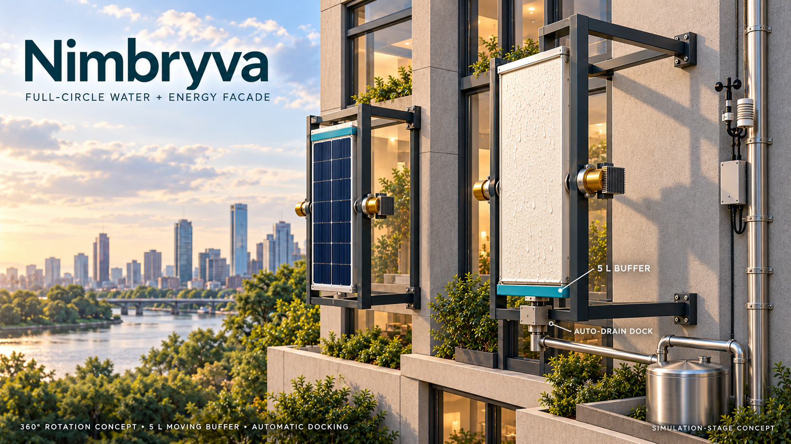
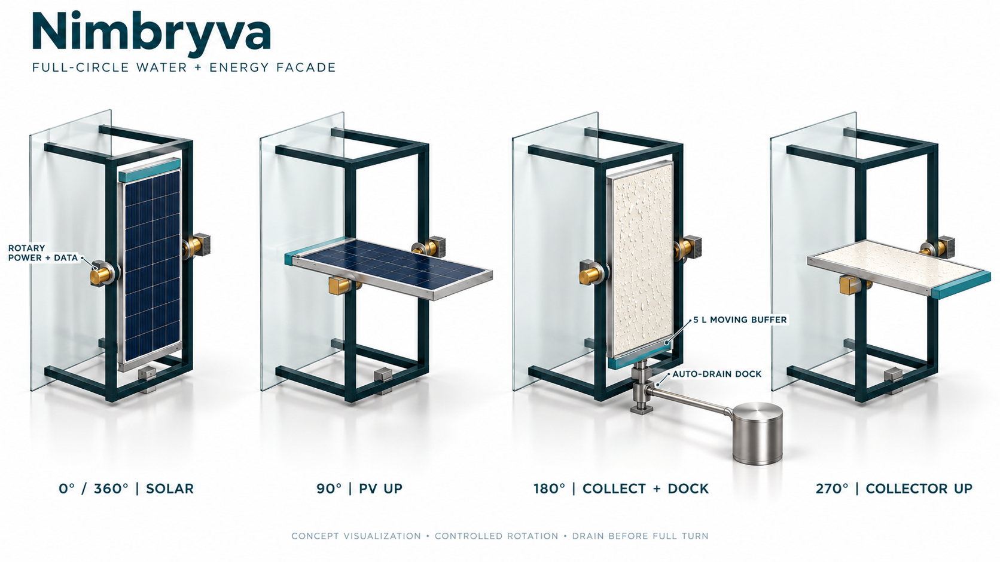

# Nimbryva

Adaptive facade research for supplemental water collection and solar energy.



*Concept artwork. This is not a photograph of built or validated hardware.*

## Current status

This repository contains **two distinct scopes**:

1. **Current 360-degree concept demonstrator:** an interactive Python model of rigid geometry and a proposed moving-buffer discharge state machine. Water inputs and timing are scripted. It does not estimate water yield, PV power, condensation, wind loads or hardware reliability.
2. **Earlier numerical research:** thermal/water/PV models, source-backed inputs, component checks, surrogate models, trained PPO policies and audited replay results from the supplied F1 archive. These results belong to the earlier architecture. They do not validate the revised 5 L moving-buffer design or demonstrate an RL improvement for it.

The next milestone is to integrate the revised mechanism into the coupled physics and controller evaluation, then test it against independent published measurements.

## Run the current concept demo

Use Python 3.11 or 3.12 with a desktop Matplotlib backend.

```bash
python -m pip install -r requirements-demo.txt
python run.py concept-demo
```

For an isolated environment, first run `python -m venv .venv`. On Windows use `.venv\Scripts\python.exe` in place of `python`; on Linux/macOS use `.venv/bin/python`. Activation is optional when you call that executable directly.

Controls:

| Control | Purpose |
|---|---|
| Full turn | Request one 360-degree turn with the proposed interlocks |
| Collector / Solar | Select the collecting face or PV face |
| Add 1 L | Inject scripted water input, unrelated to actual weather yield |
| Drain | Request discharge at the parked dock pose |
| Wind lock | Inject a test flag that blocks motion; no rated wind speed is implied |
| Reset | Reset the demonstration session |

Water collection is enabled only at the 180-degree dock pose in this minimal demonstrator. Other harvest angles and loaded return paths require validation before enabling them. Geometry permits other angles, but this demo does not claim they can harvest water effectively.

The proposed usable buffer is 5 L, with a normal discharge request at 4 L. Before a face change or full turn, drain to at most 0.2 L. A retractable coupling, closed ports and a motion interlock govern repositioning. A 4.5 L high-high request and receiver-capacity checks are also represented. These are initial design assumptions.



## Check the demonstration

```bash
python run.py concept-demo --check
python -m unittest discover -s tests -v
python run.py concept-demo --check-gui
```

The last command draws the GUI headlessly without writing a 3-D image. Passing these checks establishes software behavior and the stated rigid-geometry conditions, not physical product performance or structural safety.

## Replay the earlier numerical work

```bash
python -m pip install -r requirements.txt
python run.py presentation check
python run.py presentation view
```

This earlier viewer shows the archived geometry and recorded F1 numerical results. Its continuous curves use the shared supported prefix; dotted curves remain diagnostic. It is separate from `concept-demo`.

For reports, install `requirements-presentation.txt` and run `python run.py presentation report`. The bundled report is in `output/presentation/report-fa.html` and `output/pdf/Defensible-Report-fa.pdf`.

For research and trained-policy replay, read [the original research guide](docs/CDE-RUN-fa.md) and install the appropriate research dependencies. The selected frozen policy `results/research/E/control/ppo-7.zip` and its selection/test metadata remain in this repository. The publication preparation did not retrain it.

## Video and publication

- [Three-minute narration](video/NARRATION-en.md)
- [Timed shots and actions](video/SHOT-LIST.md)
- [Persian recording guide](video/RECORDING-fa.md)
- [GitHub upload guide](docs/GITHUB-UPLOAD-fa.md)
- [Package contents and omissions](docs/GITHUB-PACKAGE.md)

## Data and reproducibility

Normalized weather, experimental data and attribution notices remain included. The archive includes 2024 files for 12 sites and additional years for selected sites. Raw weather responses, bulk CFD meshes/fields and solver logs are omitted. Retrieval provenance and JSON case geometry remain. Recreate heavy CFD output with the documented OpenFOAM workflow before using the CFD-field viewer.

The original full-archive manifest does not describe this publication subset. See `config/provenance/github-package.json` for the source hash and omitted paths, and `RELEASE-MANIFEST.json` for this release's file hashes.

## Licenses

The original [MIT code license](LICENSE) is preserved. It applies to project code only. Third-party data and bundled fonts retain their own terms. In particular, the ETH material data carry **CC BY-NC 4.0** terms; see [their notice](data/materials/NOTICE.md), [data sources](DATA-SOURCES.md), the research notices and `assets/fonts/LICENSE-DejaVu.txt`. The code license does not grant commercial rights to those data.

The current system has no independently validated full-device performance. No annual water yield, commercial saving or revised-design RL advantage is claimed.
